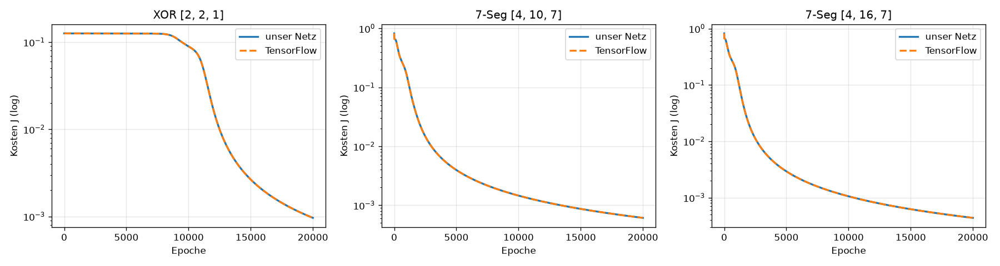
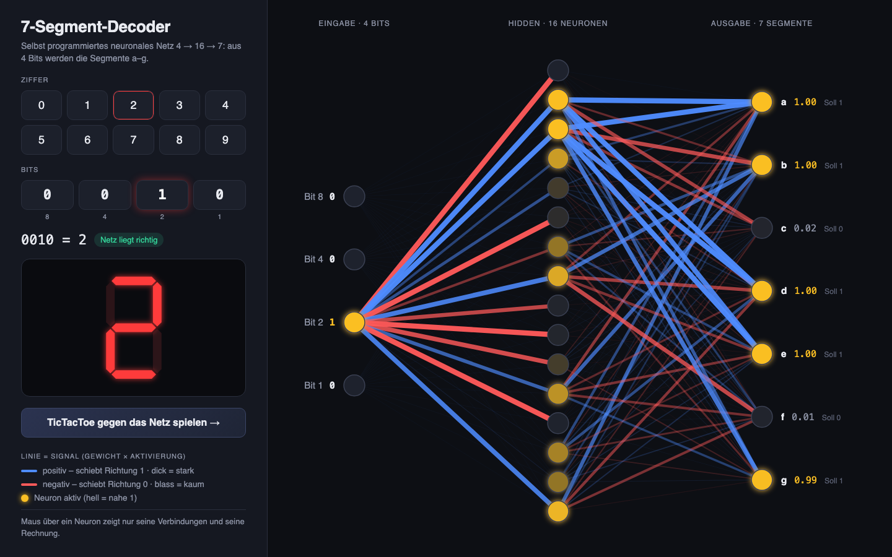
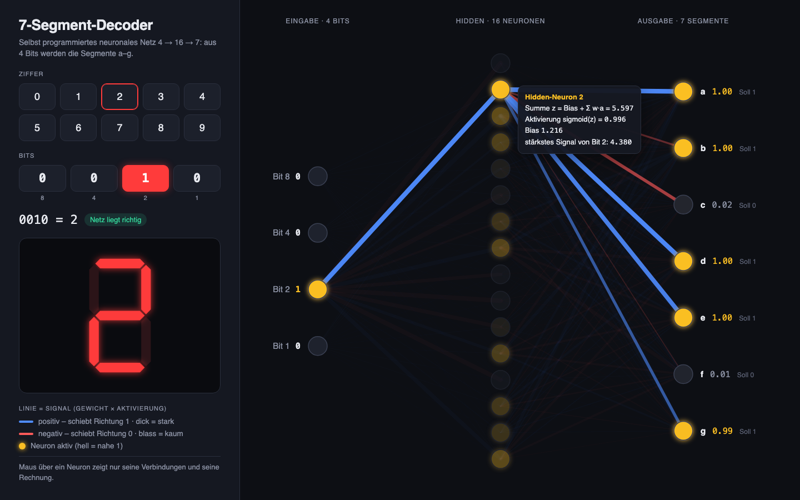
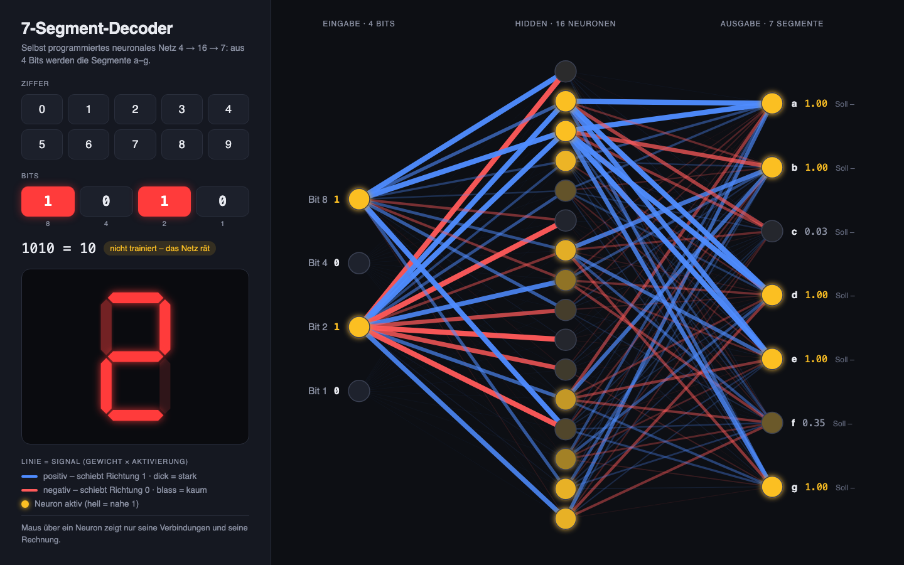
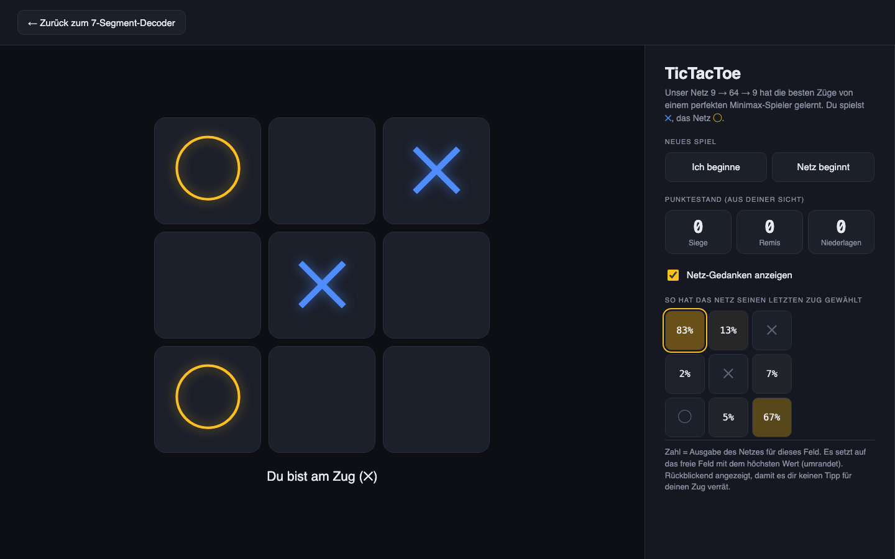

# Neuronales Netz from Scratch – Dokumentation

> 4AHITS · INSY · Aldin Mukic & Lisa Hintermaier

## 1. Aufgabenstellung

Grundlage ist `4AHITS_NN_from_scratch.pdf`. Ziel ist ein neuronales Netz **ohne fertige KI-Bibliothek**, nur mit Python und numpy. Es soll trainieren (Backpropagation), Vorhersagen machen und sich speichern und laden lassen.

| Teil | Aufgabe | Umgesetzt in |
|---|---|---|
| Part 1 | Klassen `Neuron`, `Layer`, `NeuralNetwork`; Forward, Backward, Training; Export als JSON, TXT und C-Header (.h) | `neural_network.py` |
| Part 2 | XOR (2 → 2 → 1) und 7-Segment-Decoder (4 → 16 → 7) trainieren, exportieren, neu laden, testen | `neural_network.py` |
| Part 3 | Dieselben Netze mit TensorFlow nachbauen und vergleichen | `tf_vergleich.py` |
| Part 4 | Forward-Pass in C, Gewichte aus der `.txt` | `c/nn_forward.c` |
| Part 5 | Forward-Pass in C, Gewichte aus dem `.h`-Header | `c/nn_header_main.c` |
| Part 6 | ESP32 mit echter 7-Segment-Anzeige | **entfällt** (wir arbeiten rein digital) |
| Extras | 7-Segment-Anzeige mit Netzdiagramm, TicTacToe gegen das Netz | `gui_7seg.py`, `tictactoe.py`, `web/` |

Trainingsparameter laut Angabe: **20000 Epochen, Lernrate α = 0,1**, Sigmoid als Aktivierung.

## 2. Theorie

Das Netz besteht aus Layern. Jedes Neuron ist mit allen Neuronen des vorherigen Layers verbunden. Die Schreibweise folgt dem PDF: `[1]` = Hidden-Layer, `[2]` = Output-Layer, X = A[0] = Eingabe.

### 2.1 Forward-Pass

Jedes Neuron bildet eine gewichtete Summe seiner Eingaben plus Bias und schickt sie durch die Sigmoid-Funktion:

$$Z^{[l]} = W^{[l]} A^{[l-1]} + b^{[l]} \qquad A^{[l]} = \sigma(Z^{[l]}) = \frac{1}{1 + e^{-Z^{[l]}}}$$

Sigmoid drückt jeden Wert zwischen 0 und 1. Ohne diese „Knickstelle“ wäre das ganze Netz nur eine lineare Funktion und könnte z. B. XOR nicht lernen. Die Ausgabe des letzten Layers ist die Vorhersage Ŷ = A[2].

**Im Code:** `Neuron.activate()` rechnet `sigmoid(np.dot(inputs, weights) + bias)`. `Layer.forward()` macht das für alle Neuronen eines Layers, `NeuralNetwork.forward()` reicht die Ausgabe von Layer zu Layer weiter.

### 2.2 Kostenfunktion

Wie falsch das Netz liegt, misst die Kostenfunktion (Mean Squared Error, wie im PDF):

$$J = \frac{1}{2}(\hat{Y} - Y)^2$$

Das ½ ist praktisch, weil es sich beim Ableiten wegkürzt: dJ/dŶ = Ŷ − Y. Bei mehreren Ausgängen (7-Segment) wird über alle Ausgänge summiert, und `train()` gibt pro Epoche den Mittelwert über alle Samples aus.

### 2.3 Backpropagation und Kettenregel

Um ein Gewicht zu verbessern, braucht man den Gradienten ∂J/∂W, also wie stark sich die Kosten ändern, wenn man dieses Gewicht ein bisschen verändert. Weil J über mehrere Stufen von W abhängt, multipliziert man nach der **Kettenregel** die Ableitungen entlang des Weges:

$$\frac{\partial J}{\partial W^{[2]}} = \underbrace{(A^{[2]} - Y)}_{\partial J / \partial A} \cdot \underbrace{A^{[2]}(1 - A^{[2]})}_{\sigma'(Z)} \cdot \underbrace{A^{[1]}}_{\partial Z / \partial W}$$

Für den Hidden-Layer kommt ein Glied dazu, weil der Fehler über die Gewichte W[2] zurückfließt:

$$\frac{\partial J}{\partial W^{[1]}} = (A^{[2]} - Y) \cdot \sigma'(Z^{[2]}) \cdot W^{[2]} \cdot \sigma'(Z^{[1]}) \cdot X$$

Für den Bias ist der letzte Faktor einfach 1.

**Im Code (`Layer.backward()`):**
1. Pro Neuron das **Delta** = Fehler · σ'(z) berechnen. Der Fehler kommt beim Output-Layer aus `output - target`, beim Hidden-Layer vom Layer dahinter.
2. Den Fehler für den **vorherigen Layer** berechnen: Summe aus Delta · Gewicht. Wichtig: Das passiert **mit den alten Gewichten, vor dem Update**, sonst stimmt die Kettenregel nicht mehr.
3. Erst dann die Gewichte aktualisieren: `Neuron.update()` mit Gradient = Delta · letzte Eingabe.

`NeuralNetwork.backward()` startet mit dJ/dA = A − Y und geht die Layer **rückwärts** durch, daher der Name.

### 2.4 Gradient Descent und Lernrate

Jedes Gewicht wird ein kleines Stück **gegen** den Gradienten verschoben, also bergab auf der Kostenkurve:

$$W_{neu} = W_{alt} - \alpha \cdot \frac{\partial J}{\partial W} \qquad b_{neu} = b_{alt} - \alpha \cdot \frac{\partial J}{\partial b}$$

α ist die **Lernrate** (bei uns 0,1). Ist sie zu klein, lernt das Netz langsam. Ist sie zu groß, springt es über das Minimum hinweg. Wir verwenden **Stochastic Gradient Descent (SGD)** wie im PDF: Nach **jedem einzelnen Sample** wird sofort aktualisiert, nicht erst nach allen Samples.

Am XOR sieht man ein Problem von Gradient Descent gut: Die Kosten bleiben bis ca. Epoche 8000 fast gleich, weil das Netz auf einem „Plateau“ festhängt, und fallen dann plötzlich (Diagramm in 4.4). Mit nur 2 Hidden-Neuronen kann XOR je nach Startgewichten auch in einem lokalen Minimum hängen bleiben. Deshalb setzen wir einen festen **Seed** (`np.random.seed(1)`), damit jeder Lauf gleich und reproduzierbar ist.

## 3. Aufbau des Codes

**Grundidee:** *Nur Python trainiert. Alle anderen Teile (C, Browser) rechnen nur noch vorwärts mit den exportierten Gewichten.*

```
neural_network.py  ──trainiert──►  export/  xor.json/.txt/.h   7seg.json/.txt/.h
tictactoe.py       ──trainiert──►  export/  tictactoe.json
                                      │
          ┌───────────────────────────┼──────────────────────────┐
          ▼                           ▼                          ▼
   c/nn_forward.c (Part 4)     tf_vergleich.py (Part 3)    gui_7seg.py → web/7seg.html
   c/nn_header_main.c (Part 5) gleiche Netze in TensorFlow  Forward-Pass in JavaScript
```

| Datei | Inhalt |
|---|---|
| `neural_network.py` | Klassen, Training, Export/Import (Part 1) sowie XOR und 7-Segment trainieren, exportieren, neu laden und testen (Part 2). `python3 neural_network.py` führt alles nacheinander aus. |
| `tf_vergleich.py` | Part 3: dieselben Netze in TensorFlow/Keras, Vergleichstabelle und Diagramm |
| `c/nn.h` | gemeinsamer C-Teil: Structs `Neuron`, `Layer`, `Network`, `forward()`, `predict()`, Test der Ziffern 0–9 |
| `c/nn_forward.c` | Part 4: liest `export/7seg.txt` ein (überspringt `#`-Kommentare) |
| `c/nn_header_main.c` | Part 5: bindet `export/7seg.h` ein, braucht keine Datei und kein `malloc` |
| `tictactoe.py` | Minimax, Trainingsdaten (4520 Stellungen), Training und Qualitätsmessung des TicTacToe-Netzes |
| `gui_7seg.py` | setzt die Netze in `web/vorlage_7seg.html` ein, erzeugt `web/7seg.html` und öffnet den Browser |
| `web/vorlage_7seg.html` | die Webseite: HTML/CSS und JavaScript (Forward-Pass, Netzdiagramm, TicTacToe) |

### 3.1 Klassen `Neuron`, `Layer`, `NeuralNetwork`

- **`Neuron`** speichert seine `weights` (Startwerte zufällig, `randn · 0,1`), seinen `bias` (Start 0) und die Aktivierungsfunktion. `activate()` rechnet die Ausgabe und merkt sich Eingabe, z und Ausgabe für die Backpropagation. `update()` verschiebt Gewichte und Bias um Lernrate · Gradient.
- **`Layer`** ist eine Liste von Neuronen. `forward()` ruft alle Neuronen auf, `backward()` macht die drei Schritte aus 2.3 und gibt den Fehler für den Layer davor zurück.
- **`NeuralNetwork`** wird mit den Layer-Größen erzeugt, z. B. `NeuralNetwork([4, 16, 7])`. Es bietet `train()` (Training über Epochen, gibt den Kostenverlauf zurück), `predict()`, die Export-Methoden und `load()`. Die Aktivierung wird als Name übergeben (`activation="sigmoid"`) und in `ACTIVATIONS` nachgeschlagen, weil man eine Python-Funktion nicht in eine JSON-Datei schreiben kann, nur ihren Namen.

### 3.2 Export und Import (JSON, TXT, .h)

Dasselbe trainierte Netz wird in **drei Formaten** gespeichert, jeweils für einen anderen Zweck:

| Format | Methode | Für wen | Inhalt |
|---|---|---|---|
| `.json` | `dump_json()` / `NeuralNetwork.load()` | Python und Browser | Layer-Größen, Aktivierung, Lernrate, pro Neuron `weights` und `bias` |
| `.txt` | `dump_txt()` | Menschen und C (Part 4) | lesbar mit `#`-Kommentaren; das C-Programm überspringt sie und liest nur die Zahlen der Reihe nach |
| `.h` | `dump_initfile()` | C (Part 5) | `#define`s für die Größen, Gewichte als `float`-Arrays und eine Funktion `seg7_init(&net)` |

Ausschnitt aus `export/7seg.txt`:
```
# Anzahl Layer (ohne Input)
2
# Layer-Groessen inkl. Input
4 16 7
# Layer 1, Neuron 0: bias w0 w1 w2 w3
-2.0722882805 4.2982652616 4.6650460614 -5.0075314673 -0.3481191589
```

Beim Laden baut `load()` zuerst ein Netz mit derselben Architektur (mit Zufallsgewichten) und überschreibt dann alle Gewichte und Biases mit den gespeicherten Werten.

## 4. Ergebnisse

`python3 neural_network.py` erzeugt alle Ergebnisse dieses Kapitels in ca. 8 Sekunden. Weil der Seed fest ist, kommen bei jedem Lauf dieselben Zahlen heraus.

### 4.1 XOR (2 → 2 → 1)

| Eingabe | Soll | Ausgabe | gerundet |
|---|---|---|---|
| 0 0 | 0 | 0,04 | 0 ✓ |
| 0 1 | 1 | 0,96 | 1 ✓ |
| 1 0 | 1 | 0,96 | 1 ✓ |
| 1 1 | 0 | 0,05 | 0 ✓ |

**4/4 richtig.** Die Kosten sinken von 0,126 auf 0,00096, bleiben dabei aber bis ca. Epoche 8000 fast unverändert (siehe 2.4). **Export/Import:** Das aus `export/xor.json` neu geladene Netz liefert exakt dieselben Werte, die Abweichung ist 0.

### 4.2 7-Segment-Decoder (4 → 16 → 7)

Das Netz übersetzt die Ziffern 0–9 (als 4 Bits) in die Segmente a–g. Gerundet wird bei 0,5.

- **10/10 Ziffern richtig, 70/70 Segmente richtig (100 %).**
- Alle Rohwerte liegen deutlich bei 0 (≤ 0,02) oder bei 1 (≥ 0,98), das Netz ist sich also sicher.
- Kosten: 0,822 → 0,00044.
- **Export/Import:** Das aus `export/7seg.json` neu geladene Netz weicht um 0 ab.

### 4.3 C-Implementierung (Part 4 + 5)

```bash
cd c && make run
```
Beide Programme erkennen **10/10 Ziffern**. Ihre Rohwerte stimmen auf 4 Nachkommastellen mit Python überein (z. B. Ziffer 0, Segment a: 0,9852 in Python und in C), egal ob die Gewichte aus der `.txt` (Part 4) oder aus der `.h` (Part 5) kommen. Kompiliert wird mit `clang -Wall -Wextra` ohne eine einzige Warnung.

Getestete Fehlerfälle: Eine nicht vorhandene Datei (`./nn_forward gibtsnicht.txt`) und ein falsches Netz (`./nn_forward ../export/xor.txt`, 2 statt 4 Eingänge) führen zu einer verständlichen Fehlermeldung und Rückgabewert 1, statt dass das Programm falsch rechnet.

### 4.4 Vergleich mit TensorFlow (Part 3)

```bash
.venv-tf/bin/python tf_vergleich.py      # dauert ca. 6 Minuten
```
TensorFlow läuft in einer eigenen virtuellen Umgebung `.venv-tf/`. Für Python 3.14 gibt es nur die Vorabversion **TensorFlow 2.22.0-rc0**. Für unseren Vergleich (Dense-Layer, Sigmoid, SGD) reicht sie völlig.

**Damit der Vergleich fair ist**, bekommen beide Implementierungen:
- dieselbe Architektur, Sigmoid, SGD mit Lernrate 0,1, batch_size 1 und 20000 Epochen,
- **dieselbe Kostenfunktion** ½·Σ(Ŷ−Y)². Keras' eingebautes `mse` wäre der Mittelwert ohne ½, also anders skaliert, und damit wäre die effektive Lernrate eine andere.
- **dieselben Startgewichte**: Keras übernimmt die Zufallsgewichte unseres Netzes, in float64.

| Netz | Implementierung | Trainingszeit | End-Kosten | Korrekt |
|---|---|---:|---:|---:|
| XOR [2,2,1] | unser Netz | **0,6 s** | 0,000962 | 4/4 |
| | TensorFlow | 106,7 s | 0,000962 | 4/4 |
| 7-Seg [4,10,7] | unser Netz | **6,3 s** | 0,000612 | 10/10 |
| | TensorFlow | 110,3 s | 0,000612 | 10/10 |
| 7-Seg [4,16,7] | unser Netz | **8,0 s** | 0,000437 | 10/10 |
| | TensorFlow | 113,5 s | 0,000437 | 10/10 |

**Ergebnisse:**
1. **Unsere Backpropagation ist korrekt.** Bei gleichen Startgewichten unterscheiden sich die Ausgaben beider Implementierungen um höchstens 1,5·10⁻⁹, und die End-Kosten sind identisch.
2. **Unser Netz war hier 14- bis 180-mal schneller.** TensorFlow ist für große Netze und viele Daten gebaut. Bei 2–16 Neuronen und einem Update nach jedem einzelnen Sample kostet der Verwaltungsaufwand pro Schritt mehr als die eigentliche Rechnung. Deshalb braucht TensorFlow unabhängig von der Netzgröße immer etwa 110 Sekunden.
3. Im Diagramm liegen die Kurven beider Implementierungen genau übereinander:



Die vollständige Ausgabe mit allen Rohwerten steht in `diagramme/tf_vergleich_ausgabe.txt`.

## 5. Extras
### 5.1 7-Segment-Seite: Anzeige + Blick ins Netz (im Browser)

**Starten:** `python3 gui_7seg.py`. Das Skript holt das trainierte Netz aus `export/7seg.json` (fehlt die Datei, wird es automatisch trainiert), setzt es in die Vorlage `web/vorlage_7seg.html` ein, speichert das Ergebnis als `web/7seg.html` und öffnet die Seite im Standard-Browser.

**Aufbau der Seite:** Sie nutzt den ganzen Bildschirm. Links ist eine Seitenleiste (ca. 30 % der Breite, 400–520 px), rechts füllt das Netzdiagramm den restlichen Platz und passt sich an die Fenstergröße an. Auf schmalen Fenstern rutscht die Leiste nach oben.

**Seitenleiste:**
- Ziffer-Buttons 0–9 setzen die 4 Eingangsbits automatisch.
- Die 4 Bit-Buttons (Wertigkeit 8, 4, 2, 1) lassen sich einzeln umschalten. So sind auch die Eingaben 10–15 möglich, die das Netz nie gelernt hat.
- Der Status zeigt z. B. `0010 = 2` mit einem farbigen Hinweis: „Netz liegt richtig“, „falsch“ oder „nicht trainiert – das Netz rät“.
- Die 7-Segment-Anzeige: Jedes Segment leuchtet so hell (mit leichtem Glühen), wie der Ausgabewert des Netzes ist.

**Netzdiagramm 4 → 16 → 7** (ändert sich bei jedem Klick mit einem kurzen, fließenden Übergang):
- **Linien** zeigen das **Signal = Gewicht × Aktivierung**, das gerade von einem Neuron zum nächsten fließt. Blau heißt positiv (schiebt Richtung 1), Rot heißt negativ (schiebt Richtung 0). Dick heißt starkes Signal, blass heißt kaum Signal.
- **Kugeln** leuchten gelb, je aktiver das Neuron ist.
- Links stehen die Bit-Werte, rechts pro Segment der Ausgabewert und der Sollwert.
- **Maus über ein Neuron:** Nur seine Verbindungen bleiben sichtbar, alles andere wird abgedunkelt. Eine Info-Box zeigt die Rechnung dieses Neurons: Summe z = Bias + Σ w·a, Aktivierung sigmoid(z), Bias und das stärkste eingehende Signal.





**Was man daran sieht:** Bei Ziffer 2 (`0010`) fließt nur von „Bit 2“ Signal ins Netz. Von den Eingängen mit 0 kommt nichts, denn 0 · w = 0. Bei einer ungelernten Eingabe wie `1010` (= 10) mischen sich die Signale von Bit 8 und Bit 2. Das Netz „rät“ eine Art „2“, und Segment f bleibt mit 0,35 unsicher.



**Kontrolle (automatischer Test mit headless Chrome):**
- Das JavaScript rechnet für alle 16 Eingaben wie Python. Der größte Unterschied liegt bei 5·10⁻¹¹ und entsteht nur durchs Runden.
- Die Klicks funktionieren: Ziffer 5 → „richtig“, Bit 8 dazu → 13 „nicht trainiert“.
- Das Diagramm hat 176 Linien und 27 Kugeln. Die Anzahl der Linien mit Signal zwischen Input und Hidden passt genau zur Zahl der gesetzten Bits (Ziffer 0 → 0, 8 → 16, 5 → 32, 7 → 48 von 64).
- Fehlt `export/7seg.json`, wird das Netz automatisch trainiert, und Netz und Seite sind identisch mit vorher.
- Beim echten Start liegt Safari ganz vorne, auch vor VS Code im Vollbild.
- Hover: Über Hidden-Neuron 1 werden genau 11 Linien hervorgehoben (4 ein, 7 aus), danach wieder 0.
- Das Aussehen wurde per Screenshot geprüft: Laptop (1440×900), schmales Fenster (800 px) und Safari.

#### Entscheidung 1: Browser statt Tkinter
Die erste Version war ein Tkinter-Fenster (Screenshots: `diagramme/alt_tkinter_7seg_*.png`). Beim Testen ist ein Problem aufgefallen:
- **Problem:** Das Tkinter-Fenster erschien beim Start **nicht im Vordergrund**. Läuft VS Code im Vollbild, öffnet macOS das Fenster auf einem anderen Schreibtisch (Space), und man sieht es nicht. Zwei Versuche, das Fenster per Programm nach vorne zu holen (Tk `lift`/`topmost` und macOS „System Events“), hatten keinen Erfolg. Seit macOS 14 dürfen sich Programme, die aus dem Terminal gestartet werden, nicht selbst in den Vordergrund drängen.
- **Lösung:** Die Anzeige wurde als **Webseite** neu gebaut. Ein Browser, der über `webbrowser.open()` gestartet wird, darf sich in den Vordergrund holen.
- **Wo rechnet das Netz?** Python trainiert und liefert die Gewichte. Im Browser läuft nur der **Forward-Pass in JavaScript**, etwa 5 Zeilen, genau wie in C bei Part 4/5. Es ist kein Server nötig, und die erzeugte `web/7seg.html` funktioniert auch per Doppelklick.

#### Entscheidung 2: Eine Seite, Signal statt Gewicht, kein Abspielen
Zwischendurch gab es eine eigene Seite `gui_gewichte.py` (Screenshots: `diagramme/alt_gewichte_*.png`). Sie hatte XOR und 7-Segment, einen Play-Button, der das Training von Epoche 0 bis 20000 abspielte, und eine Kostenkurve. Die Linien zeigten dort das **Gewicht w** selbst.
- **Warum geändert?** Gewünscht war *eine* Seite, auf der sich das Netzbild **bei jeder Eingabe** sichtbar ändert, ohne Drumherum. Das trainierte Gewicht w ist aber fest. Deshalb blieb das Bild beim Klicken fast gleich, nur die Deckkraft änderte sich leicht.
- **Lösung:** Jetzt zeigt jede Linie das **Signal w · a**, also genau den Summanden `w_j · x_j` aus dem Forward-Pass. Weil sich die Aktivierungen a mit jeder Eingabe ändern, ändert sich das ganze Bild. Streng genommen ändern sich dabei nicht die Gewichte, sondern ihr Beitrag.
- **Folgen:** `gui_gewichte.py` und der dafür eingebaute `callback`-Parameter in `train()` wurden entfernt. Getestet: `neural_network.py` liefert danach byte-genau dieselben Netze. Die doppelte Tabelle „Ausgaben des Netzes“ ist weggefallen, weil die Werte jetzt im Diagramm stehen. Anzeige und Netz stehen nebeneinander, damit alles auf einen Bildschirm passt.

#### Entscheidung 3: Vollbild-Design statt Karte
Die erste Fassung der kombinierten Seite steckte in einer schmalen Karte in der Mitte (Screenshots: `diagramme/alt_karte_7seg_*.png`), und das Netz war zu klein, um es genau zu erkennen. Neu: Vollbild mit Seitenleiste, das Netz nutzt den ganzen restlichen Platz, dazu das Hervorheben per Maus und die Info-Box. Beim Testen der neuen Fassung sind drei Fehler aufgefallen und behoben worden:
- Beim Öffnen „fuhr“ die Anzeige sichtbar hoch. Lösung: Übergänge erst nach dem ersten Zeichnen einschalten.
- Nach der automatischen Größenanpassung ging die Hervorhebung verloren, und alles war abgedunkelt. Lösung: Der Fokus wird gemerkt und nach dem Neuaufbau wieder gesetzt.
- Auf schmalen Fenstern wurde die Seitenleiste abgeschnitten. Lösung: Die Seitenhöhe ist dort nicht mehr auf den Bildschirm begrenzt.

### 5.2 TicTacToe gegen das Netz

**Starten:** In der Seitenleiste auf **„TicTacToe gegen das Netz spielen →“** klicken. Das Spiel ist eine zweite Ansicht derselben Seite (Adresse endet auf `#tictactoe`). Mit **„← Zurück zum 7-Segment-Decoder“** oder mit dem Zurück-Button des Browsers geht es wieder zurück. Das trainierte Netz liegt in `export/tictactoe.json`. Fehlt die Datei, trainiert `gui_7seg.py` es automatisch (ca. 3 Minuten). Neu trainieren geht mit `python3 tictactoe.py`.

**Wie das Netz TicTacToe gelernt hat (`tictactoe.py`):**
1. **Brett als Eingabe:** 9 Felder, immer aus Sicht des Spielers am Zug: +1 = eigener Stein, −1 = Gegner, 0 = leer. So reicht ein Netz für beide Seiten.
2. **Lehrer = Minimax:** Minimax probiert rekursiv alle Spielverläufe durch und spielt dadurch perfekt. Er bevorzugt schnelle Siege und späte Niederlagen, deshalb blockt er auch in schon verlorenen Stellungen und setzt nicht „irgendwohin“. Mit `lru_cache` wird jede Stellung nur einmal berechnet.
3. **Trainingsdaten:** alle 4520 Stellungen, die in einem echten Spiel vorkommen können. Das Ziel ist 1 für jedes optimale Feld, sonst 0.
4. **Training:** unsere eigene `NeuralNetwork`-Klasse, Netz 9 → 64 → 9, 300 Epochen, Lernrate 0,1, SGD. Die Reihenfolge der Stellungen wird in jeder Epoche gemischt. Dauer: ca. 2,5 Minuten.
5. **Spielen:** Das Netz setzt auf das freie Feld mit der höchsten Ausgabe.

**Wie gut spielt es?** (Ausgabe in `diagramme/tictactoe_training.txt`)

| Messung | Ergebnis |
|---|---|
| optimaler Zug in allen 4520 Stellungen | 4463 (98,7 %) |
| gegen Zufallsspieler, Netz beginnt (1000 Spiele) | 985 Siege, 15 Remis, **0 Niederlagen** |
| gegen Zufallsspieler, Gegner beginnt (1000 Spiele) | 806 Siege, 177 Remis, 17 Niederlagen |
| gegen Minimax, Netz beginnt | Remis |
| gegen Minimax, Minimax beginnt | Niederlage |

Das Netz ist also sehr gut, aber **nicht perfekt**. Es gibt eine Handvoll Stellungen, in denen es den falschen Zug wählt, und die kann man als Spieler finden. Ein Versuch mit 800 statt 300 Epochen brachte keine Verbesserung: ebenfalls 98,7 %, 15 statt 17 Niederlagen, dafür 7 statt 2,5 Minuten Training (`diagramme/tictactoe_versuch_800_epochen.txt`). Deshalb bleibt es bei 300 Epochen.

**Spielansicht:** Man kann wählen, wer beginnt, und es gibt einen Punktestand. Mit dem Schalter **„Netz-Gedanken anzeigen“** (standardmäßig aus) zeigt ein Nebenbrett die Ausgaben des Netzes bei seinem **letzten** Zug; das gewählte Feld ist umrandet. Das wird absichtlich *rückblickend* angezeigt: Eine Live-Anzeige würde verraten, wo das Netz hinsetzen will, und oft ist das genau der beste Zug für den Menschen.



**Kontrolle (automatischer Test mit headless Chrome):**
- Das JavaScript im Browser wählt in **allen 4520 Stellungen** denselben Zug wie Python.
- Ein Spiel per Klick läuft korrekt ab: Das Netz antwortet, am Ende gibt es ein Ergebnis und einen Punktestand, und ein Klick nach Spielende ändert nichts.
- Bei „Netz beginnt“ setzt das Netz sofort genau einen Stein.
- Das umrandete Feld in den Netz-Gedanken ist das Feld, das das Netz gesetzt hat.
- Der Wechsel zwischen den Ansichten funktioniert in beide Richtungen.

## 6. Anleitung zum Ausführen

Alle Befehle im Projektordner ausführen. Voraussetzung: Python 3 mit numpy, für Part 4/5 ein C-Compiler (clang).

| Was | Befehl | Dauer |
|---|---|---|
| Part 1 + 2: XOR und 7-Segment trainieren, exportieren, laden, testen | `python3 neural_network.py` | ca. 8 s |
| Part 4 + 5: C-Programme bauen und starten | `cd c && make run` | < 1 s |
| Part 3: Vergleich mit TensorFlow | `.venv-tf/bin/python tf_vergleich.py` | ca. 6 min |
| Schneller TensorFlow-Test mit nur 2000 Epochen | `.venv-tf/bin/python tf_vergleich.py 2000` | ca. 1 min |
| TicTacToe-Netz neu trainieren | `python3 tictactoe.py` | ca. 2,5 min |
| **Webseite** (7-Segment + Netzdiagramm + TicTacToe) | `python3 gui_7seg.py` | ein paar Sekunden |

Fehlen die trainierten Netze in `export/`, trainiert `gui_7seg.py` sie automatisch. Die erzeugte `web/7seg.html` lässt sich auch per Doppelklick öffnen.

**Die TensorFlow-Umgebung neu anlegen** (nur nötig, wenn `.venv-tf/` fehlt):
```bash
python3 -m venv .venv-tf
.venv-tf/bin/pip install tensorflow matplotlib
```

## 7. Arbeit mit der KI

Das Projekt wurde zusammen mit der KI **Claude Code** umgesetzt. Alle Prompts mit Ergebnis stehen in `PROMPTS.md`.

**Vorgehen:**
- **Erst planen, dann programmieren:** Aus dem PDF entstand zuerst ein Plan mit 7 Phasen (`PLAN.md`), bevor Code geschrieben wurde. Unklare Punkte (Umfang, Visualisierung, Dateistruktur) hat die KI vorher nachgefragt.
- **Phase für Phase mit Abstimmung:** Nach jeder Phase wurde das Ergebnis vorgestellt, und erst nach meinem OK ging es weiter.
- **Feste Regeln in `CLAUDE.md`:** Diese Datei lädt die KI in jeder Sitzung automatisch. Darin steht unter anderem: bei Unklarheiten nachfragen, nichts ohne Erlaubnis installieren, deutsche Kommentare in gesunder Menge, alles testen.
- **Alles testen:** Jede Phase wurde geprüft, auch Fehlerfälle wie fehlende Dateien oder falsche Eingaben. Die Webseite wurde automatisch mit headless Chrome getestet (Rechnung, Klicks, Screenshots).

**Kurswechsel, die sich beim Arbeiten ergeben haben** (alle in Kapitel 5 begründet):
- Tkinter-Fenster → Webseite, weil das Fenster bei VS Code im Vollbild nicht im Vordergrund erschien.
- eigene Gewichte-Seite mit Abspielen des Trainings → eine einzige Seite, auf der sich das Netzbild bei jedem Klick ändert. Das ging auf ein Missverständnis zurück, das wir gemeinsam aufgeklärt haben.
- Design als kleine Karte → Vollbild mit Seitenleiste, danach noch die Größenverhältnisse nachjustiert.
- TicTacToe: Minimax wurde verbessert, nachdem beim Testen auffiel, dass er in verlorenen Stellungen nicht mehr blockt.

**Was die KI gemacht hat und was ich:** Die KI hat den Code geschrieben, getestet und die Doku formuliert. Ich habe die Anforderungen und Regeln festgelegt, jede Phase geprüft und abgenommen, Entscheidungen getroffen (Umfang, Browser statt Tkinter, Design, TicTacToe-Bedienung) und Ergebnisse, die mir nicht gefallen haben, zurückgewiesen.
