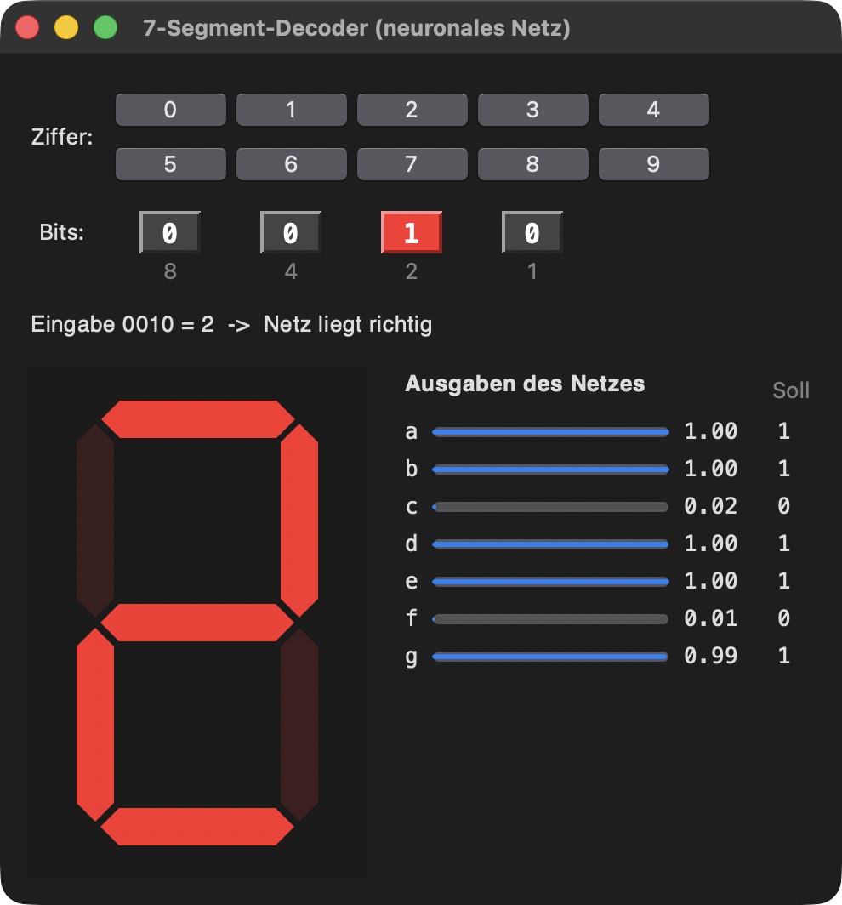
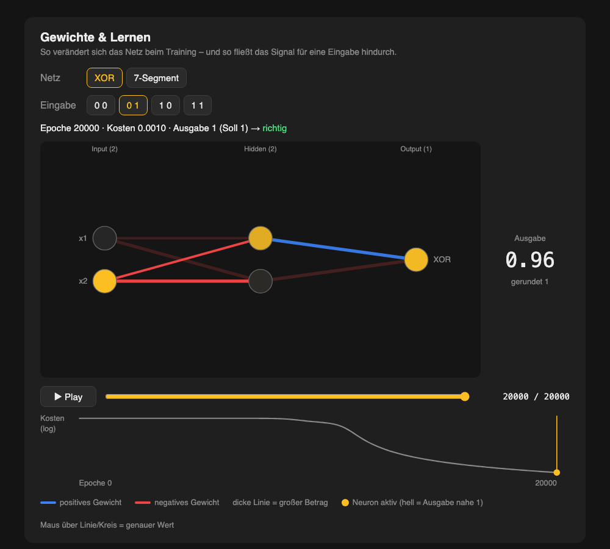
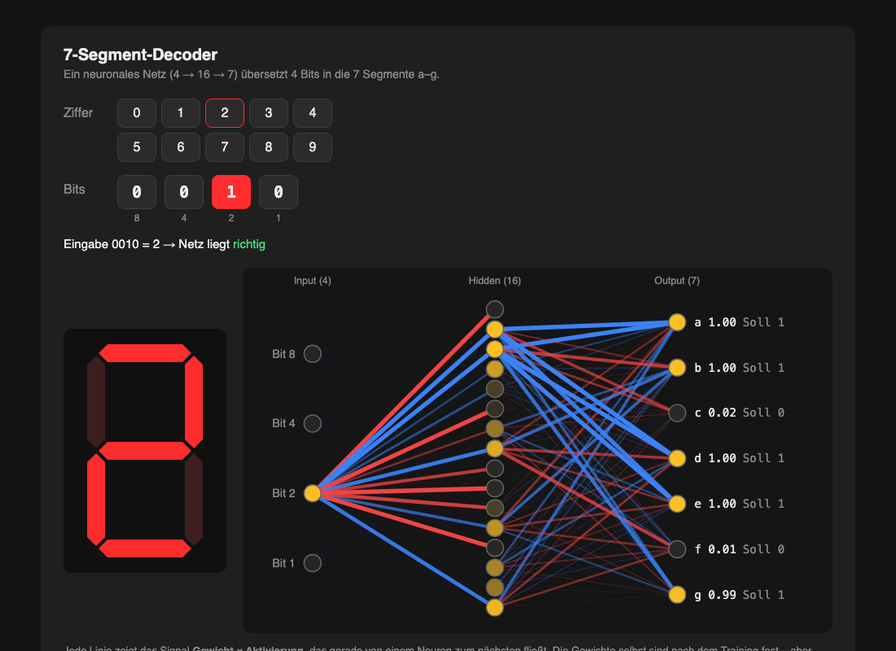

# Worum geht es? {.unnumbered}

Wir haben ein **neuronales Netz komplett selbst programmiert**, ohne fertige KI-Bibliothek, nur mit Python und numpy. Es **lernt** (Backpropagation), **speichert** sich ab und läuft danach auch **in C** und **im Browser**. Grundlage war die Angabe `4AHITS_NN_from_scratch.pdf`, Part 1–5. **Part 6 (ESP32) haben wir bewusst weggelassen**, weil wir rein digital arbeiten.

Gearbeitet haben wir mit der KI **Claude Code**. Uns war dabei wichtig, **nicht einfach drauflos programmieren zu lassen**, sondern zu planen, mitzuentscheiden und jeden Schritt zu prüfen.

::: {.callout-tip}
## Das Projekt in Zahlen
**Part 1–5 umgesetzt** · XOR **4/4** · 7-Segment **10/10** · C rechnet **gleich wie Python** · TensorFlow-Vergleich: **gleiche Ergebnisse, unser Netz bis zu 180× schneller** · TicTacToe-Netz spielt in **98,7 %** der Stellungen perfekt · **36 Prompts**, ca. **1,5 h** reine KI-Arbeitszeit
:::

# Wie wir es in Gang gesetzt haben

## Unsere Ausgangslage

Wir hatten ein **Grundgerüst** (`neural_network 1.py`) mit den Klassen `Neuron`, `Layer` und `NeuralNetwork`, das XOR schon lernen konnte. Bevor die KI etwas programmieren durfte, haben wir unsere Wünsche festgehalten:

- **Zuerst ein Plan**, dann besprechen, erst dann Code
- Die KI soll **nachfragen**, statt etwas anzunehmen
- **Kommentare auf Deutsch** in der „gesunden Mitte“: verständlich, aber nicht zu lang
- Der 7-Segment-Decoder soll **schön visualisiert** werden, als Extras **TicTacToe** und eine **Visualisierung der Gewichte**
- Eine **Dokumentation inklusive aller Prompts**, mit Zeit und Tokens

## Erst planen, dann programmieren

Die KI hat zuerst das PDF und unseren Code gelesen und dann **Rückfragen** gestellt: Welche Parts genau? Womit visualisieren? Eine Datei oder mehrere? Daraus entstand ein **Plan mit 7 Phasen**, den wir freigegeben haben:

| Phase | Inhalt |
|---|---|
| 0 | Setup: Datei umbenennen, Regeln und Doku-Dateien anlegen |
| 1 | Part 1: Speichern und Laden (JSON, TXT, C-Header) |
| 2 | Part 2: XOR und 7-Segment trainieren, speichern, laden, testen |
| 3 | Part 4 + 5: Forward-Pass in C |
| 4 | Part 3: Vergleich mit TensorFlow |
| 5 | Extras: 7-Segment-Webseite mit Netzdiagramm, TicTacToe |
| 6 | Dokumentation |

**Nach jeder Phase** haben wir uns das Ergebnis angesehen. **Erst nach unserem OK** ging es weiter.

## Die Regeln und Dateien, die das zusammengehalten haben

| Datei | Wozu |
|---|---|
| **`CLAUDE.md`** | Die **Regeln für die KI**. Wird in jeder Sitzung automatisch geladen und ist sozusagen das Gedächtnis des Projekts. |
| **`PLAN.md`** | Die Phasen mit **Status-Checkliste**: Wo stehen wir? |
| **`PROMPTS.md`** | **Jeder Prompt** mit Ergebnis, Zeit und Tokens, damit nachvollziehbar ist, *wie* wir mit der KI gearbeitet haben |
| **`DOKUMENTATION.md`** | Die technische Doku (Theorie, Code, Ergebnisse); dieses Dokument baut darauf auf |

Eine Regel kam **unterwegs dazu**: Als die erste Fensterversion nicht gleich funktionierte, haben wir festgelegt, dass die KI **alles von vorne bis hinten testen** muss, auch Fehlerfälle wie fehlende Dateien, und Probleme **selbst behebt, bevor** sie etwas als fertig meldet.

# Was ging schnell – und was nicht

| Phase | Prompts | KI-Zeit | Eindruck |
|---|---:|---:|---|
| Planung + Setup | 4 | 3,6 min | Rückfragen klärten den Umfang |
| Part 1 + 2 (Python) | 3 | 4,4 min | **schnell und auf Anhieb richtig** |
| Part 4 + 5 (C) | 1 | 1,6 min | **schnell**, C rechnete sofort wie Python |
| Part 3 (TensorFlow) | 5 | 25,7 min | **langsam**, vor allem Wartezeit (siehe unten) |
| Extras | **16** | **49,8 min** | **die meiste Arbeit**, mehrere Kurswechsel |
| Doku + Fragen | 7 | 5,9 min | |

**Was schnell ging:** Die Pflichtaufgaben in Python und C waren nach **wenigen Minuten** fertig und haben sofort funktioniert. Das lag am **guten Plan**: Speicherformate und Datenstrukturen waren vorher festgelegt, sodass C die exportierten Dateien direkt verwenden konnte.

**Was nicht schnell ging:**

- **TensorFlow:** Für unser Python 3.14 gab es nur eine **Vorabversion**. Wir haben gemeinsam entschieden, diese zu nehmen, statt ein zweites Python zu installieren. Außerdem braucht TensorFlow für unsere kleinen Netze rund **110 s** statt **1–8 s**, deshalb dauerten die Testläufe lange.
- **Die Extras:** **16 von 36 Prompts** und mehr als die Hälfte der Zeit. Hier haben wir am meisten **nachgebessert**, und das war auch gut so.

# Wo wir nachbessern mussten

## Fenster → Webseite

Die erste 7-Segment-Anzeige war ein **Python-Fenster (Tkinter)**. **Problem:** Bei VS Code im Vollbild erschien das Fenster **nicht im Vordergrund**, man hat es gar nicht gesehen. Zwei Versuche, das per Programm zu lösen, scheiterten, weil macOS das bewusst verhindert. **Unsere Idee:** eine **Webseite**, die sich automatisch im Browser öffnet. Ein Browser darf sich nach vorne holen, und **das Problem war gelöst**.

## Ein Missverständnis bei der Gewichte-Visualisierung

Die KI baute zuerst eine **eigene Seite**, auf der man das **Training abspielen** konnte (Play-Button, Kostenkurve). Ein **Kollege** hatte es anders gelöst: Bei ihm **änderte sich das Netzbild bei jedem Klick**. Wir haben gemeinsam überlegt, warum:

- Die KI hatte „**alle Extras im Browser**“ als *mehrere* Seiten verstanden, gemeint war **eine** Seite.
- Die KI zeichnete das **Gewicht** selbst. Das ist nach dem Training aber fest, deshalb änderte sich beim Klicken fast nichts.
- **Lösung:** Jede Linie zeigt jetzt das **Signal = Gewicht × Aktivierung**. Das hängt von der Eingabe ab, also **ändert sich das Bild bei jedem Klick**.

::: {.callout-note}
**Was wir daraus gelernt haben:** Bei Wörtern wie „alles“ oder „die Gewichte“ lohnt es sich, **genau zu sagen, was gemeint ist**. Missverständnisse kosten mehr Zeit als eine kurze Rückfrage.
:::

## Das Design: zweimal überarbeitet

Die kombinierte Seite steckte zuerst in einem **kleinen Rechteck** in der Mitte, und das Netz war **zu klein** zum Erkennen. Neu: **Vollbild** mit Seitenleiste, und das Netz nutzt den ganzen Platz. Danach war das Netz **zu groß** und die Seitenleiste zu gedrängt, also haben wir die **Größenverhältnisse** noch einmal angepasst.

::: {layout-ncol=3}

:::

## Kleinere Stolpersteine

- **Screenshots zum Testen** funktionierten erst, nachdem wir **VS Code die Bildschirmaufnahme erlaubt** hatten.
- Die KI fand beim Testen **selbst Fehler** und behob sie: Die Anzeige „fuhr“ beim Öffnen hoch, die Hervorhebung ging nach einer Größenänderung verloren, und auf schmalen Fenstern war die Seitenleiste abgeschnitten.
- **TicTacToe:** Der „Lehrer“-Algorithmus blockte in schon verlorenen Stellungen nicht mehr. Das haben wir verbessert, weil das Netz sonst ein **schlechtes Vorbild** gehabt hätte. Ein längeres Training (800 statt 300 Epochen) brachte **keine Verbesserung**, deshalb blieb es bei 300.

# Wichtige Überlegungen

- **Ein Netz, viele Orte:** **Nur Python trainiert.** C und der Browser rechnen nur noch vorwärts mit den gespeicherten Gewichten, genau so, wie es später auf einem Mikrocontroller wäre.
- **Fairer Vergleich mit TensorFlow:** **gleiche Startgewichte**, **gleiche Kostenfunktion**, gleiche Lernrate. Nur so kann man sehen, ob unsere Mathematik stimmt, und sie stimmt.
- **Netz-Gedanken bei TicTacToe nur rückblickend:** Unsere Frage war: *„Verrät die Anzeige nicht, wo das Netz hinsetzt?“* Genau. Deshalb zeigt sie die Bewertung **erst nach** dem Zug des Netzes und ist **standardmäßig aus**.
- **Nichts ohne Erlaubnis installieren:** TensorFlow, matplotlib und Quarto wurden **erst nach Rückfrage** installiert.

# Ergebnisse

| Aufgabe | Ergebnis |
|---|---|
| **XOR** (2 → 2 → 1) | **4/4** richtig (Ausgaben 0,04 · 0,96 · 0,96 · 0,05) |
| **7-Segment** (4 → 16 → 7) | **10/10** Ziffern, 70/70 Segmente |
| **Speichern und Laden** | geladenes Netz = Original, **Abweichung 0** |
| **C** (Part 4 + 5) | **10/10**, Werte auf 4 Stellen **gleich wie Python** |
| **TensorFlow** (Part 3) | gleiche Ergebnisse (Unterschied ~10⁻⁹), **unser Netz 14–180× schneller** |
| **TicTacToe** | **98,7 %** perfekte Züge, verliert nie gegen Zufall, wenn es beginnt |

# Technik kompakt

::: {.callout-note collapse="true"}
## Wie das Netz rechnet (Theorie)
**Vorwärts:** Jedes Neuron bildet eine gewichtete Summe plus Bias und schickt sie durch die Sigmoid-Funktion:
$$Z = W \cdot A_{davor} + b \qquad A = \sigma(Z) = \frac{1}{1+e^{-Z}}$$

**Fehler:** $J = \frac{1}{2}(\hat{Y} - Y)^2$, also wie weit die Ausgabe vom Sollwert entfernt ist.

**Rückwärts (Backpropagation):** Mit der **Kettenregel** wird berechnet, wie stark jedes Gewicht am Fehler schuld ist, z. B.
$$\frac{\partial J}{\partial W^{[2]}} = (A^{[2]} - Y) \cdot A^{[2]}(1-A^{[2]}) \cdot A^{[1]}$$

**Lernen (Gradient Descent):** Jedes Gewicht wird ein kleines Stück in die Richtung verschoben, in der der Fehler kleiner wird: $W_{neu} = W_{alt} - \alpha \cdot \frac{\partial J}{\partial W}$, mit Lernrate $\alpha = 0{,}1$ und 20000 Epochen.
:::

::: {.callout-note collapse="true"}
## Aufbau des Codes
| Datei | Inhalt |
|---|---|
| `neural_network.py` | Klassen `Neuron`, `Layer`, `NeuralNetwork`, Training, Speichern/Laden, XOR + 7-Segment (Part 1 + 2) |
| `c/` | Forward-Pass in C: liest die `.txt` (Part 4) bzw. bindet die `.h` ein (Part 5) |
| `tf_vergleich.py` | Part 3: dieselben Netze in TensorFlow |
| `tictactoe.py` | Minimax als „Lehrer“, Training des TicTacToe-Netzes |
| `gui_7seg.py` + `web/` | erzeugt die Webseite und öffnet sie im Browser |

**Grundidee:** Python trainiert und speichert das Netz in drei Formaten: **JSON** (für Python und Browser), **TXT** (lesbar, für C) und **C-Header** (Gewichte direkt im C-Code).
:::

::: {.callout-note collapse="true"}
## Wie TicTacToe funktioniert
1. Das **Brett wird zu 9 Zahlen**: +1 = Netz, −1 = Gegner, 0 = leer.
2. **Minimax** (selbst programmiert) probiert alle Spielverläufe durch und kennt so den besten Zug. Damit haben wir für **alle 4520 möglichen Stellungen** den besten Zug berechnet.
3. Unser Netz (9 → 64 → 9) **lernt** diese Züge mit derselben Backpropagation wie oben.
4. Beim Spielen setzt das Netz auf das **freie Feld mit der höchsten Ausgabe**.
:::

::: {.callout-note collapse="true"}
## Starten
| Was | Befehl |
|---|---|
| Part 1 + 2 | `python3 neural_network.py` |
| Part 4 + 5 (C) | `cd c && make run` |
| Part 3 (TensorFlow) | `.venv-tf/bin/python tf_vergleich.py` |
| Webseite mit 7-Segment und TicTacToe | `python3 gui_7seg.py` |
| Dieses Dokument neu erzeugen | `~/Applications/quarto/bin/quarto render dokumentation.qmd` |
:::

# Fazit

- **Planen hat sich ausgezahlt:** Die Pflichtaufgaben liefen **schnell und fehlerfrei**, weil vorher klar war, was gebaut wird.
- **Die meiste Arbeit steckte nicht im Programmieren, sondern im Abstimmen:** Bei den Extras mussten wir **mehrmals nachschärfen**, bis es so war, wie wir es uns vorgestellt hatten.
- **Die KI hat programmiert, wir haben entschieden:** Wir haben den Umfang festgelegt, Ergebnisse geprüft, Vorschläge **abgelehnt**, wenn sie uns nicht gefallen haben, und Missverständnisse aufgeklärt.
- **Testen ist Pflicht:** Mehrere Fehler fielen erst beim gründlichen Testen auf, zum Glück **vor** der Abgabe.

::: {.callout-tip collapse="true"}
## Zeit und Tokens (berechnet aus dem Gesprächsverlauf)
| | Wert |
|---|---|
| reine Arbeitszeit der KI | **ca. 91 min** (Lese- und Testzeit von uns nicht eingerechnet) |
| Sitzungen | 29.09.2026 (15:57–23:29) und 13.10.2026 |
| Prompts | 36 |
| von der KI geschrieben | ca. 300.000 Tokens |
| neu eingelesen | ca. 1,6 Mio. Tokens |

Details pro Prompt stehen in `PROMPTS.md`.
:::
